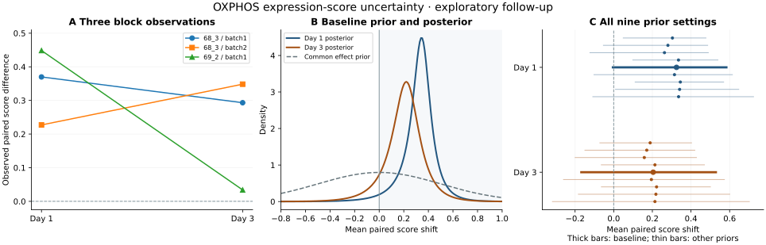
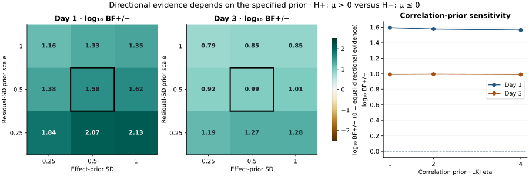
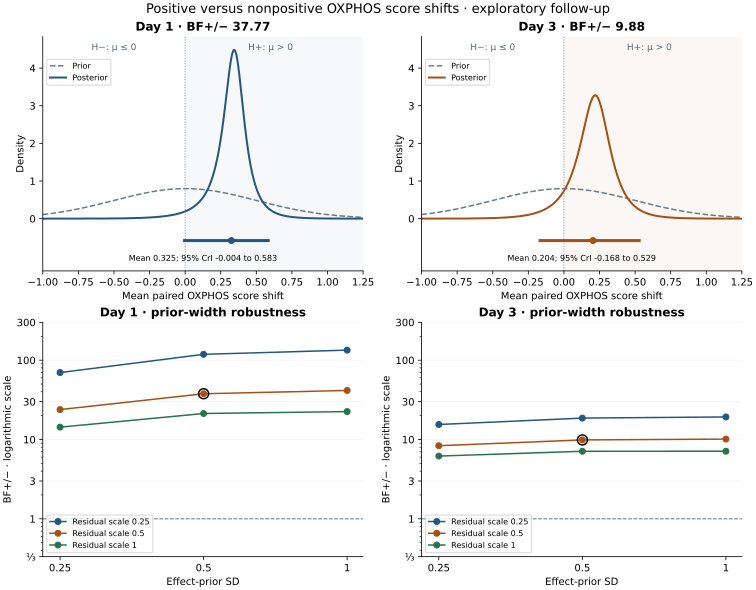

# OXPHOS directional evidence — exploratory follow-up

This post hoc extension compares **H+: a positive mean OXPHOS expression-score shift** with **H−: a nonpositive shift**, separately for Day 1 and Day 3 relative to the available common controls. It is not a test of an exactly zero effect. It re-expresses existing posterior directional information and adds deterministic numerical checks and correlation-prior sensitivity; it supplies no new observations or independent confirmation.

## Results

With the baseline normal likelihood, Normal(0, 0.5) mean priors, HalfNormal(0.5) residual-SD priors and LKJ(2) correlation prior:

| Contrast | Posterior mean | Equal-tail 95% CrI | P(positive) | BF+/− |
|---|---:|---:|---:|---:|
| Day 1 / common control | 0.325 | −0.004 to 0.583 | 0.974 | 37.77 |
| Day 3 / common control | 0.204 | −0.168 to 0.529 | 0.908 | 9.88 |

The units are average log₂(normalized count + 1) differences across all 182 mapped OXPHOS genes. These are not gene log₂ fold changes. The evidence updates prior directional odds of 1:1 to approximately 37.8:1 and 9.9:1 under these particular models. It does not establish 37.8:1 odds against an exact-zero null, or a probability of increased respiration. The two marginal day-specific factors must not be multiplied: the paired observations and posterior means are dependent.

Across the entire declared 3 × 3 normal prior-scale grid, BF+/− ranges from **14.33 to 134.00 for Day 1** and **6.18 to 19.26 for Day 3**. Directional preference is consistent across these settings; its magnitude is prior-sensitive. The existing Student-t(4) baseline fit is retained separately as a transformation of archived Monte Carlo sign probabilities, not a new Student-t fit. Complete outputs include both additional LKJ(1) and LKJ(4) baseline checks; no setting was selected because it gave the largest factor.

A 95% credible interval containing zero is compatible with a directional Bayes factor favouring H+: these summaries answer different questions. In particular, the refined baseline Day-1 interval extends slightly below zero, while the archived NUTS interval starts slightly above zero. The deterministic estimates and the historical Monte Carlo summaries remain separately identified; this small endpoint difference must not become a binary scientific claim.

## Interactive exploration

In the atlas, choose **Confidence & interpretation → Bayesian OXPHOS**. Native Framework7 logarithmic sliders vary effect-prior SD and residual-SD prior scale from 0.125 to 2; a separate selector controls LKJ eta. Exact computational values are shown while dragging, and calculation occurs on release. The original nine-setting sensitivity grid remains visible. Values outside that grid are explicitly identified as additional user exploration.

Each day displays BF+/− and its reciprocal, median, mean and 95% interval. The probability wheel shows posterior directional probabilities under the stated prior odds of 1:1; it is not a graphical conversion of a Bayes factor into an unconditional probability. H+ and H− remain positive and nonpositive score shifts, not effect and point-null models. Custom values and diagnostics are retained in the JSON export.

## Model and computation

The inputs are the existing three paired differentiation-block observations, spanning two genetic backgrounds. The bivariate-normal likelihood retains within-block dependence from shared controls. Conditional posterior means and variances are analytic normals at each covariance grid point. Numerical integration uses log-spaced marginal SDs with Jacobians, linearly spaced correlation and trapezoid edge weights. The two directional models are normalized sign restrictions of the same proper encompassing prior, inheriting its nuisance-parameter priors. Because each prior sign has probability 0.5, BF+/− = P(μ>0 | y) / P(μ≤0 | y).

All 22 declared normal-model day/prior combinations passed the numerical criteria. Refinement from 90 × 90 × 151 to 130 × 130 × 221 covariance nodes changed log₁₀ BF by at most **0.000172**; the largest refined posterior grid-edge mass was **8.04 × 10⁻⁷**. Across the original prior grid, positive probabilities differed from the archived NUTS estimates by at most 0.00158 (Day 1) and 0.00541 (Day 3). These comparisons do not make the browser approximation the archived sampler. Numerical convergence and agreement do not validate the sampling model with only three blocks.

Reproduce with:

```sh
OPENBLAS_NUM_THREADS=1 python src/transcriptomics/bayesian_directional.py
python src/transcriptomics/plot_bayesian_directional.py
node --test explorer/test/bayesian-directional.test.js
```

The [specification](../config/bayesian_directional_v1.json) and [plan](bayesian_directional_plan_v1.md) explicitly acknowledge that existing posterior directions were already known. [Input/protocol hashes and numerical provenance](../tables/bayesian_directional/provenance.json), the [complete normal sensitivity table](../tables/bayesian_directional/normal_sensitivity.csv), [archived sign-probability transformations](../tables/bayesian_directional/archived_directional.csv) and [baseline density data](../tables/bayesian_directional/baseline_densities.csv) accompany the plots.

## Figures



**Expression-score uncertainty.** A: paired block observations, retaining all three blocks. B: the common zero-centred effect prior and day-specific marginal posteriors; the positive side is H+. C: means and equal-tail 95% credible intervals for all nine declared normal-prior settings; thick marks identify the baseline. The score is relative RNA expression, not protein abundance or mitochondrial activity.



**Prior sensitivity.** Cells show log₁₀ BF+/− for both days across all nine effect/residual-prior combinations, with LKJ(2) fixed; the outlined cell is the pre-existing baseline. The common scale is centred at equal directional evidence (zero). The separate panel varies LKJ eta at baseline effect/residual scales. There is no discovery threshold or FDR interpretation. [Download the three-page vector figure PDF](../figures/bayesian_directional/directional_analysis_figures.pdf).



**Annotated evidence display.** The two days have shared density axes. These are distributions under the unrestricted encompassing model; H+ and H− restrict its two sign regions. Dashed grey curves show the common effect prior, solid curves the marginal posteriors; the shaded positive region is H+. The bars below the density show equal-tail 95% credible intervals, with posterior means marked. The lower panels show BF+/− on a logarithmic scale against effect-prior SD, separately for each of the three declared residual-prior scales with LKJ(2) fixed. Lines connect the three calculated settings and do not imply additional fits; rings identify the baseline. The display follows useful JASP reporting conventions while retaining this analysis's bivariate score model and sign-restricted hypotheses. It does not use JASP's default t-test or a point-null comparison.

## Interpretation and limitations

The observed data favour a positive over a nonpositive OXPHOS score shift under the declared models. They do not determine a biologically important magnitude, resolve common-control harvest composition, establish a treatment-by-time interaction or increase biological replication. Dependence between the two differentiations from one background cannot be separately estimated. No equivalence margin is defined, and absence of respiration/protein measurements remains unchanged. All primary analyses and historical results are preserved.

Methodological basis: [Klugkist, Kato & Hoijtink, 2005, encompassing priors](https://doi.org/10.1111/j.1467-9574.2005.00279.x); [Kruschke, 2021, Bayesian Analysis Reporting Guidelines](https://doi.org/10.1038/s41562-021-01177-7). The published identity motivates the directional comparison; the scientific interpretation and numerical calculations above are specific to this secondary analysis.
